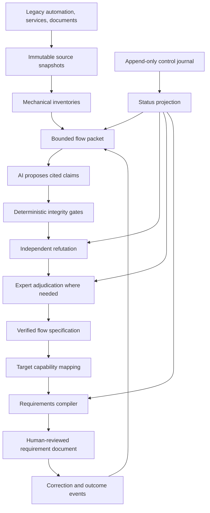

# From Legacy Automation to Trustworthy Requirements

## A reusable architecture for evidence-backed system migration analysis

Organizations often need to retire a legacy automation tool and the services it
depends on while moving the underlying business flows to a replacement
platform. The visible deliverables may be requirement documents, but the hard
problem is reconstructing trustworthy intent from code, configuration,
documents, and human knowledge without inventing missing behavior.

This guide applies the concepts in
[Provenance-First Knowledge Intelligence](PROVENANCE_FIRST_KNOWLEDGE_INTELLIGENCE.md)
to that migration pattern.

## 1. Reframe the goal

Do not treat the task as document generation. Treat it as a controlled evidence
translation pipeline:

```text
legacy behavior
    -> cited flow specification
    -> independently verified interpretation
    -> explicit target-capability mapping
    -> traceable requirement document
```

The requirement document is the final projection. The durable knowledge is the
verified chain explaining why every requirement exists.

This distinction matters because fluent drafting can hide weak evidence. A
well-written unsupported requirement is still unsupported.

## 2. Typical evidence landscape

The source material may include:

- a spreadsheet, script collection, desktop utility, or workflow tool;
- source code for legacy services it invokes;
- source code and configuration for the replacement platform;
- API specifications and schemas;
- operational documents, meeting records, and internal knowledge pages;
- explanations and corrections from maintainers and domain experts;
- approved requirement documents used as format exemplars.

These sources do not have equal authority. Code may prove implemented behavior
without proving business intent. A domain expert may prove intent without
proving that a target capability exists. A trustworthy system preserves these
roles rather than flattening all text into one search index.

## 3. What the provenance-first architecture contributes

| Migration need | Applicable concept |
|---|---|
| Resume safely after sessions or process failures | Event sourcing and durable work state |
| Prove which version was analyzed | Content-addressed storage and version binding |
| Prevent invented behavior | Claim-level provenance and citation gates |
| Keep work bounded | Stable work atoms and deterministic context packets |
| Combine code, documents, and expert input | Typed evidence and knowledge relations |
| Apply only relevant knowledge | Scope-aware retrieval and a context compiler |
| Challenge plausible but wrong interpretations | Independent adversarial evaluation |
| Preserve expert control | Human authority, curation, revocation, and active learning |
| Scale without losing visibility | Durable control records and projected dashboards |
| Consider training safely | Separate evidence, evaluation, and training admission |

The architecture does not provide language-specific parsers, business-domain
semantics, or a target capability model. Those are adapters built on top of the
evidence and control foundation.

## 4. Reference architecture



The evidence plane and control plane remain separate:

- The evidence plane stores sources, claims, citations, mappings,
  contradictions, decisions, and outputs.
- The control plane stores owners, states, dependencies, returned artifacts,
  reviews, stalls, and acceptance receipts.

Interfaces and dashboards project those durable records. They are not the
source of truth.

## 5. Minimal domain model

### Source artifact

An immutable or version-bound input with a stable identity, origin, media type,
digest, confidentiality class, and acquisition receipt.

### Flow

A bounded unit of behavior with a trigger, inputs, validations,
transformations, branches, service calls, side effects, outputs, and failure
paths.

### Claim

One independently reviewable statement about behavior or intent. A claim has:

- a stable id;
- a claim type;
- exact evidence references;
- source role;
- confidence;
- scope;
- author or extractor;
- verification state;
- contradictions and later decisions.

### Capability

A replacement-platform ability proved by code, tests, configuration, approved
documentation, or an authorized expert.

### Mapping

A cited relation between a verified legacy requirement and a target capability.
Useful states include:

- direct;
- supported through configuration;
- supported through orchestration;
- partial;
- gap;
- intentionally retired;
- unresolved.

### Decision

An authorized acceptance, rejection, correction, scope clarification, gap
disposition, or supersession event.

### Requirement document

A generated or edited projection whose requirements trace back to verified
claims, accepted mappings, or explicitly marked open questions.

## 6. Source authority matrix

Define which source can prove which kind of statement before running AI.

| Statement | Strong evidence | Insufficient on its own |
|---|---|---|
| The legacy tool executes an operation | Exact source and reproducible observation | A meeting summary |
| A legacy service produces an effect | Handler, service, schema, and tests | Endpoint name similarity |
| The target platform supports a capability | Target code, tests, configuration, or approved specification | A generated mapping proposal |
| A behavior is required business intent | Authorized expert decision plus supporting context | Legacy implementation alone |
| A document follows the accepted format | Approved exemplars and review rubric | Unreviewed generated prose |

Conflicts should remain visible. The system must not silently treat the newest,
longest, or most semantically similar source as authoritative.

## 7. Bounded context packets

Do not ask an agent to inspect every repository and document for every flow.
Build a deterministic dispatcher that assembles one packet containing:

- the exact legacy entry point and source ranges;
- mechanically resolved helper and service calls;
- exact relevant legacy service specifications;
- a small set of candidate target capabilities;
- relevant document ranges;
- applicable expert corrections;
- required output schema;
- required gates;
- packet and source digests.

The model must return the packet digest with its output. This makes the result
reproducible and exposes context drift.

Record why a source was included and, where important, why a candidate was
excluded. Retrieval is part of the decision history.

## 8. Deterministic and model-based responsibilities

### Use deterministic software for

- source extraction;
- file and repository identity;
- procedure, route, schema, and call-site inventories;
- strict record validation;
- citation existence and range checks;
- identity, chronology, and relation integrity;
- context-packet construction;
- work lifecycle enforcement;
- release and admission gates;
- backup and restore verification.

### Use AI for

- proposing business interpretations;
- extracting candidate preconditions, branches, outcomes, and exceptions;
- finding semantic capability candidates;
- identifying ambiguities and missing evidence;
- adversarially challenging candidate specifications;
- drafting requirement language from verified facts.

### Keep humans authoritative for

- intent;
- conflict resolution;
- retirement decisions;
- gap acceptance;
- consequential target mappings;
- final requirement approval;
- evaluation or training admission.

This hybrid design makes each component do the work it is suited for. A model
should not be trusted to enforce hashes. A parser should not be expected to
understand unstated business intent.

## 9. Retrieval and the context compiler

Retrieval-Augmented Generation is useful when knowledge changes, must remain
cited, or can be revoked. Retrieval should filter candidates by:

- source role;
- artifact and platform version;
- scope;
- authority;
- lifecycle state;
- confidentiality permission;
- relation to the current flow;
- provenance completeness.

Semantic similarity nominates evidence. It does not authorize a mapping.

The context compiler then turns retrieved and verified records into an
executable contract:

```text
verified flow + accepted mappings + applicable decisions + format exemplars
    -> mandatory requirements
    -> gaps and open questions
    -> required citations
    -> prohibited unsupported claims
    -> output schema
    -> bounded generation packet
```

The exact compiled contract is versioned with the generated output.

## 10. Independent verification

The verification pass should try to refute the candidate flow specification,
not edit it for style.

For each claim, the verifier returns one of:

- supported;
- contradicted;
- overstated;
- under-specified;
- citation mismatch;
- plausible alternative;
- missing source;
- requires expert judgment.

Author and verifier should not share the same conversational context. Both
receive the same frozen evidence packet. Disagreements are first-class records
and are routed to an authorized person when their impact or uncertainty is
high.

## 11. Gates

1. **Source gate:** every input is immutable or version-bound.
2. **Inventory gate:** every flow resolves to an entry point and exact source
   ranges.
3. **Citation gate:** every behavioral claim cites evidence.
4. **Support gate:** cited evidence actually supports the claim.
5. **Schema gate:** all typed records validate strictly.
6. **Lineage gate:** relations resolve exact identities and versions.
7. **Refutation gate:** every candidate flow receives an independent challenge.
8. **Conflict gate:** unresolved disagreement remains visible.
9. **Mapping gate:** every legacy requirement has an explicit mapping state.
10. **Traceability gate:** every generated requirement resolves to a verified
    claim, accepted mapping, or marked open question.
11. **Expert gate:** high-risk or sampled cases receive authorized review.
12. **Release gate:** only reviewed artifacts with complete receipts are called
    finished.

Honest states such as `NOT_FOUND`, `GAP`, and `UNRESOLVED` are valid outcomes.
They prevent missing knowledge from being replaced by invented certainty.

## 12. Implementation phases

### Phase 0: Trustworthy workspace

- classify sources and access boundaries;
- establish stable identities and content digests;
- create an append-only event journal;
- create a per-flow work ledger;
- create current-state projections;
- add a resume gate that detects missing or contradictory state.

### Phase 1: Mechanical extraction

- extract legacy automation sources repeatably;
- inventory entry points, helpers, inputs, outputs, service calls, and side
  effects;
- freeze repository and document versions;
- compare repeated extraction to prove determinism;
- avoid behavioral interpretation at this stage.

### Phase 2: Source maps

- build legacy service records;
- build target capability records;
- index document ranges;
- define flow, claim, capability, mapping, contradiction, and decision schemas;
- validate source and relation integrity.

### Phase 3: Per-flow specification

- assemble one bounded packet;
- extract candidate claims;
- enforce citations and schema;
- run independent refutation;
- route material conflicts and uncertainty for expert adjudication;
- land a verified flow specification.

### Phase 4: Capability mapping

- retrieve target candidates;
- compare semantics, data, and operational behavior;
- classify each relation;
- preserve gaps and retirement decisions;
- review high-risk mappings.

### Phase 5: Requirement compilation

- compile one verified flow and its mappings;
- draft using approved format exemplars;
- verify complete traceability;
- capture review corrections as new evidence;
- release with an acceptance receipt.

### Phase 6: Scale and learn

- measure repeated corrections and expert effort;
- use active learning to prioritize high-information questions;
- improve retrieval and context compilation;
- calibrate AI judges against human outcomes;
- consider model adaptation only when evidence reveals a repeated residual gap.

## 13. Evaluation

### Integrity

- percentage of sources bound to exact versions;
- repeatable extraction rate;
- citation validity;
- broken relation count;
- context-packet reproducibility;
- restore success.

### Claim quality

- precision on an expert-reviewed sample;
- important omission rate;
- citation-support accuracy;
- scope accuracy;
- verifier agreement with experts;
- unresolved ambiguity rate.

### Mapping quality

- precision on a target-expert sample;
- false direct-match rate;
- true gap detection;
- invented capability count, which should be zero;
- mappings supported by evidence on both sides.

### Output quality

- traceability coverage;
- unsupported requirement count, which should be zero;
- human acceptance rate;
- revision rounds;
- time to accepted output;
- downstream defect escape rate.

Evaluation sets should be split by flow family and time. Closely related helper
and parent flows should remain on the same side of a development or evaluation
split.

## 14. Should the system be fine-tuned?

Usually not at the beginning.

Migration knowledge is version-specific, source-specific, and expected to
remain traceable. That favors retrieval and deterministic context compilation.
Fine-tuning can hide stale knowledge in weights and make individual claims hard
to revoke.

Later, curated evidence may support bounded experiments such as:

- claim-type classification;
- retrieval reranking;
- uncertainty or risk prediction;
- a judge calibrated to human verdicts;
- style adaptation using approved document exemplars.

Before any weight-changing run, require:

- explicit record-level admission;
- a frozen data manifest;
- leakage-resistant holdouts;
- a strong retrieval-only baseline;
- regression tests;
- rollback artifacts;
- human release approval.

Labeling and data preparation are not training. A training run is not proof of
product quality.

## 15. Practical first demonstrator

Choose one representative flow and build the entire lineage:

1. immutable source manifest;
2. deterministic source extraction;
3. mechanical flow inventory;
4. exact legacy service context;
5. target capability candidates;
6. cited candidate specification;
7. independent refutation;
8. expert disposition;
9. explicit mapping table;
10. compiled requirement document with full traceability.

Run the packet twice in fresh contexts. Compare claims, citations, and
uncertainty. The demonstrator succeeds when another session can reproduce the
state without chat history, unsupported claims are zero, and reviewers can see
why every requirement exists.

## 16. Concepts learned through the project

| Concept | Practical use |
|---|---|
| Event sourcing | Durable work, review, correction, and release history |
| Content-addressed storage | Exact source, packet, and output identity |
| Provenance and lineage | Claim-to-code-to-mapping-to-requirement traceability |
| Static analysis | Entry-point, call-graph, input, output, and service inventories |
| Knowledge representation | Typed flows, claims, capabilities, and relations |
| RAG | Governed retrieval of relevant source evidence |
| Context engineering | Deterministic bounded task packets |
| Hybrid AI systems | Code for invariants and models for semantics |
| Human-in-the-loop learning | High-value expert adjudication and corrections |
| Active learning | Selection of the most informative expert questions |
| AI evaluation | Refutation, blind comparison, and held-out flows |
| MLOps and DataOps | Versioned data, prompts, models, metrics, and rollback |
| Fine-tuning | A later optional experiment rather than the memory layer |

## 17. Final principle

The durable product is not only a set of documents. It is a reproducible,
challengeable chain from observed legacy behavior and authorized intent to
target requirements.

Models, repositories, and target platforms will change. Evidence identity,
provenance, explicit authority, and controlled lifecycle transitions let the
knowledge survive those changes.
