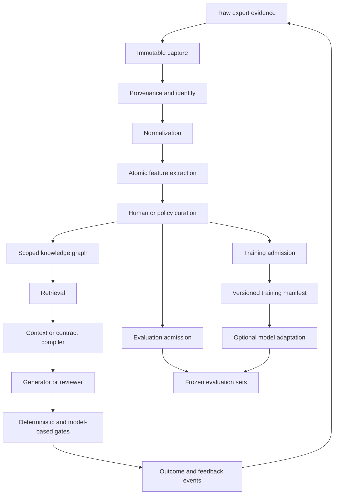
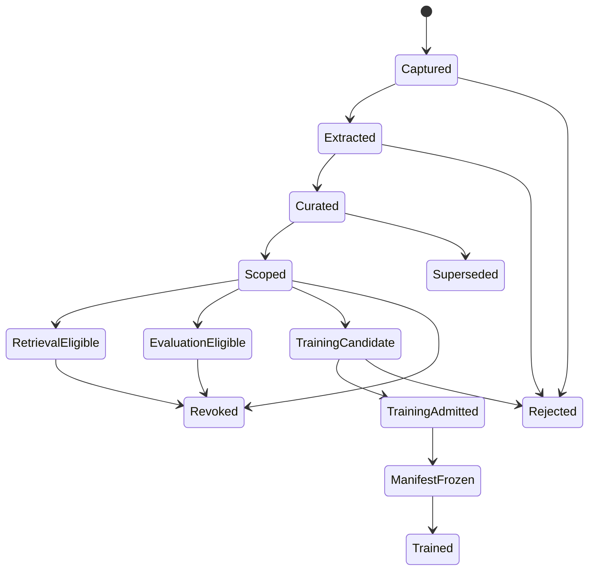

# Provenance-First Knowledge Intelligence

## A reusable architecture for turning expert feedback into durable, controllable AI knowledge

This guide describes a general architecture for systems that must learn from a
domain expert over time without losing corrections, inventing authority, or
silently turning every comment into training data.

It is suitable for design review, legal operations, medical knowledge
management, software architecture, editorial systems, manufacturing quality,
research workflows, customer-support policy, and other domains where judgment
is valuable, context changes, and the history behind a decision matters.

The central idea is simple:

> Do not begin with model training. Begin by building a trustworthy memory of
> evidence, meaning, authority, and outcomes. Then make retrieval, evaluation,
> and training consume that memory through explicit gates.

This is not only an AI architecture. It is a combination of data engineering,
event sourcing, knowledge representation, human-in-the-loop learning,
evaluation design, and optional model adaptation.

## 1. The problem this architecture solves

Many AI systems appear to learn during a conversation but do not create durable
knowledge. A user corrects an output, the next output improves, and everyone
assumes the system has learned. In reality, one of several weaker things may
have happened:

- the correction remained only in the current context window;
- a summary retained an incomplete paraphrase;
- a rule was written but is not retrieved consistently;
- the artifact changed, so the original evidence can no longer be inspected;
- a preference was promoted into a universal rule without authority;
- a training dataset was assembled without preserving why each label exists;
- a model was evaluated on examples that leaked from its training context;
- work was delegated, but no durable return or acceptance state was recorded.

A knowledge-intelligence system must answer seven questions for every claimed
lesson:

1. What exactly happened?
2. Which evidence proves it?
3. Who expressed the judgment?
4. What did the judgment refer to at that moment?
5. Where is the judgment allowed to apply?
6. What later event confirmed, changed, rejected, or superseded it?
7. Which consumers may use it for retrieval, evaluation, generation, or
   training?

If any answer is missing, the information can still be stored as evidence, but
it should not silently become authoritative knowledge.

## 2. Reference architecture



The key separations are intentional:

- Capture is not extraction.
- Extraction is not approval.
- Approval is not global authority.
- Retrieval is not training.
- Evaluation admission is not training admission.
- A training manifest is not a training run.
- A successful training run is not proof of product quality.

## 3. The data lifecycle



Each transition should be explicit, append-only, attributable, and reversible
through a later event. A mutable status field can be projected for convenience,
but the events are the durable truth.

## 4. Concept map: what is software, what is AI, and what is training

| Layer | Main concept | Deterministic software or AI? | Changes model weights? |
|---|---|---|---|
| Capture | Event sourcing, content-addressed storage | Deterministic software | No |
| Grounding | Provenance, lineage, version binding | Deterministic software | No |
| Extraction | Multimodal feature extraction | Usually AI plus validators | No |
| Normalization | Schemas, canonicalization, identity | Deterministic software | No |
| Curation | Human-in-the-loop adjudication | Human plus optional AI advice | No |
| Knowledge | Scoped atoms and relations | Deterministic data model | No |
| Retrieval | RAG and filtered search | Search plus optional embeddings | No |
| Compilation | Context or policy compiler | Mostly deterministic | No |
| Generation | Language or multimodal model | AI inference | No |
| Evaluation | Blind comparison, judges, metrics | Software, humans, and AI | No |
| Admission | Authority and governance gates | Deterministic control plane | No |
| Adaptation | LoRA, QLoRA, DPO, reward modeling | Model training | Yes |
| Operations | MLOps, observability, rollback | Deterministic infrastructure | Sometimes |

This table prevents a common misunderstanding: labeling and preparing data are
necessary for training, but they are not themselves training.

## 5. Core concepts in detail

### 5.1 Event sourcing

**What it is**

Event sourcing stores meaningful changes as immutable events instead of keeping
only the latest mutable state.

Examples include:

- feedback captured;
- interpretation proposed;
- scope confirmed;
- preference accepted;
- rule rejected;
- work assigned;
- work returned;
- result accepted;
- authority revoked.

**How it is used**

The system appends every important transition to a journal. Dashboards rebuild
current state from that journal. A status such as `accepted` is therefore a
projection of history, not an unsupported overwrite.

**Inputs**

- event type;
- actor;
- timestamp;
- subject identity;
- previous-state expectation;
- payload;
- payload digest;
- operation identity for idempotency.

**Outputs**

- immutable event;
- projected current state;
- audit history;
- restart-safe resume point.

**Why it helps**

It prevents session loss, invisible work, accidental double execution, and
status claims with no history. It also makes disagreement and reversal normal:
a later event can supersede an earlier one without deleting it.

**When it is excessive**

For a small, disposable prototype with no meaningful authority or history, a
simple database row may be sufficient.

### 5.2 Content-addressed storage

**What it is**

An artifact is stored or referenced by a cryptographic digest of its bytes,
usually SHA-256.

**How it is used**

Raw evidence, snapshots, crops, model inputs, model outputs, schemas, and
evaluation packets receive hashes. A claim about version A remains bound to the
exact bytes the expert saw, even if the working artifact later changes.

**Why it helps**

- detects silent mutation;
- deduplicates identical evidence;
- makes A/B comparisons reproducible;
- supports safe backups and restores;
- prevents a current file path from impersonating historical evidence.

**Important limitation**

A hash proves byte identity, not truth, quality, authorship, or authority. Those
properties require additional provenance and governance records.

### 5.3 Provenance and data lineage

**What it is**

Provenance records where information came from and how it was transformed.
Lineage connects source evidence to interpretations, decisions, consumers, and
later outcomes.

**How it is used**

Every normalized lesson points back to:

- the source record;
- the exact source bytes or event;
- the speaker or rater;
- the artifact version;
- the referenced region or semantic target;
- the extraction method;
- the transformation history.

**Why it helps**

When an AI interpretation is wrong, provenance lets a reviewer identify whether
the problem came from the raw evidence, the extraction, the scope, the authority
decision, or the consumer. Without lineage, all corrections become vague prompt
edits.

### 5.4 Spatial and multimodal grounding

**What it is**

Feedback often refers to part of an image, diagram, audio segment, video frame,
document range, or interface state. Multimodal grounding binds words to that
referent.

**How it is used**

A feedback record may include:

- the full artifact snapshot;
- a point, rectangle, polygon, or lasso path;
- a padded preview crop;
- hit-tested element identities;
- nearby text or structure;
- the expert's exact words;
- uncertainty about what the mark includes.

The crop is useful for review, but the full snapshot plus geometry is the
authority. The crop can always be regenerated from them.

**Why it helps**

It turns statements such as "move this," "I like this balance," or "this arrow
is misleading" into evidence that another reviewer or model can inspect.

**A and B outcomes**

If the expert later edits the artifact, version B can be captured and related to
version A. The system should support both cases:

- A exists and B exists: learn from the transition and the outcome.
- A exists and B does not exist: retain a correction or preference request
  without inventing the desired result.

### 5.5 Normalization

**What it is**

Normalization converts heterogeneous evidence into a stable schema while
preserving the original evidence losslessly.

**How it is used**

Different inputs such as comments, A/B choices, annotations, edit histories,
test failures, and review reports are represented using shared fields:

- identity;
- source;
- exact words;
- modality;
- subject;
- polarity;
- scope;
- confidence;
- authority;
- evidence references;
- lifecycle state;
- consumer permissions.

**Why it helps**

Search, evaluation, and training cannot reliably consume a pile of unrelated
formats. A normalized representation enables consistent filtering and
validation without erasing the raw source.

**Critical rule**

Normalization may add an interpretation, but it must not rewrite history. Keep
both the raw source and the normalized record.

### 5.6 Canonical serialization and strict schemas

**What it is**

Strict schemas define allowed fields and types. Canonical serialization turns a
valid object into one deterministic byte representation before hashing.

**How it is used**

- reject unknown or missing fields;
- reject duplicate JSON keys;
- reject invalid UTF-8;
- canonicalize key ordering and numbers;
- hash the canonical bytes;
- validate cross-record identities and relations separately.

**Why it helps**

Two semantically similar objects should not receive different identities merely
because their keys were ordered differently. Conversely, malformed or ambiguous
input should not be silently repaired at a trust boundary.

**Schema validation is not enough**

A schema can prove that a field called `authorityId` is a string. It cannot prove
that the authority exists, applies to this subject, predates the decision, and
has not been revoked. Semantic validation must check those relationships.

### 5.7 Atomic knowledge representation

**What it is**

An atom is the smallest useful, independently traceable unit of knowledge or
preference.

An atom should be small enough that a reviewer can accept one part and reject
another. For example, "use high contrast" and "use blue" should not be one atom
if their scope or authority can differ.

**Typical fields**

```json
{
  "id": "feature-unique-id",
  "claim": "A concise interpretation",
  "kind": "preference",
  "polarity": "positive",
  "dimensions": ["hierarchy", "readability"],
  "scope": {
    "level": "artifact-family",
    "subjects": ["example-family"]
  },
  "evidenceRefs": ["sha256:..."],
  "authorityState": "unconfirmed",
  "confidence": "medium",
  "consumerPermissions": []
}
```

**Why it helps**

- precise retrieval;
- precise disagreement;
- scoped reuse;
- measurable coverage;
- clean evaluation labels;
- safe promotion and revocation.

### 5.8 Authority, scope, and policy

**What it is**

Authority answers who may turn evidence into a rule and where that rule applies.
Scope prevents a local observation from becoming a universal law.

**Useful scope levels**

- region;
- element;
- artifact;
- artifact family;
- workflow;
- domain;
- global.

**How it is used**

An authority receipt binds:

- the authority source;
- the exact governed subject;
- intended meaning;
- allowed scope;
- affected dimensions;
- effective time;
- expiration or revocation;
- permitted consumers.

**Why it helps**

Experts frequently make comments that are deliberately local. An AI system
that generalizes them automatically can become rigid, bland, or wrong. Scoped
authority preserves nuance while still enabling reuse.

### 5.9 Knowledge graphs and lifecycle relations

**What it is**

A knowledge graph represents records as nodes and typed relations as edges.

Useful relations include:

- derives from;
- classifies;
- supports;
- contradicts;
- supersedes;
- duplicates;
- authorizes;
- revokes;
- admitted to evaluation;
- admitted to training;
- consumed by.

**How it is used**

The system resolves every relation endpoint by identity and digest. It rejects
duplicate ids, broken references, impossible chronology, cycles where forbidden,
and unrelated prior grants.

**Why it helps**

Knowledge changes. Graph relations preserve that change without flattening the
latest answer into an untraceable document.

### 5.10 Retrieval-Augmented Generation

**What it is**

Retrieval-Augmented Generation, or RAG, fetches relevant external knowledge and
places it in a model's context for the current task.

**How it is used**

Retrieval should filter by more than semantic similarity. A robust query also
checks:

- authority state;
- scope applicability;
- artifact or task type;
- time validity;
- supersession state;
- modality;
- consumer permission;
- confidence;
- provenance completeness.

**Inputs**

- task description;
- current artifact metadata;
- desired consumer, such as reviewer or generator;
- retrieval policy.

**Outputs**

- a small set of relevant atoms;
- their evidence and authority receipts;
- exclusions and unresolved conflicts.

**Why it helps**

RAG updates quickly, preserves citations, and does not require weight-changing
training. It is usually the first mechanism to try when knowledge changes often
or must remain inspectable.

**Why naive vector search is insufficient**

The most semantically similar statement may be revoked, local to a different
subject, or written by a non-authoritative reviewer. Similarity finds candidates;
governance decides applicability.

### 5.11 The context or policy compiler

**What it is**

A compiler converts retrieved knowledge into an executable task contract. It is
ordinary software, although an AI model may propose inputs for it.

**Pipeline**

```text
task + artifact metadata
    -> retrieve candidate atoms
    -> resolve authority and conflicts
    -> apply precedence and scope
    -> compile requirements, preferences, checks, and open questions
    -> emit a bounded context packet
```

**Typical output**

- must-follow rules;
- soft preferences;
- positive exemplars;
- counterexamples;
- required evidence;
- forbidden transformations;
- unresolved conflicts;
- deterministic gates;
- output schema.

**Why it helps**

Models are unreliable at remembering which documents to read and which clauses
apply. The compiler makes applicability deterministic and keeps prompts small.
It also records exactly what knowledge a model received, which makes later
evaluation meaningful.

### 5.12 Hybrid symbolic and model-based reasoning

**What it is**

Some checks are better expressed as code; others require perception or judgment.
A mature system uses both.

**Use deterministic checks for**

- schema validity;
- hashes and identity;
- required fields;
- file or record existence;
- chronology;
- scope intersections;
- numerical thresholds;
- lifecycle transitions;
- admission permissions.

**Use AI judgment for**

- visual balance;
- semantic equivalence;
- narrative quality;
- ambiguous referents;
- novelty;
- style coherence;
- extracting candidate atoms from rich evidence.

**Why it helps**

Code gives repeatability. Models give flexibility. Asking a model to enforce
hash identity wastes intelligence and reduces reliability. Asking a rigid rule
engine to judge subtle taste produces shallow proxies.

### 5.13 Human-in-the-loop learning

**What it is**

Humans do not manually label everything. They resolve the decisions for which
their judgment has the highest value.

**Low-friction feedback forms**

- accept or reject a candidate;
- choose A or B;
- mark a region and comment;
- state what was liked;
- state what should change;
- edit the artifact directly;
- confirm whether a lesson is local or reusable;
- adjudicate an AI disagreement.

**Why it helps**

The expert's normal work becomes the labeling process. This reduces separate
annotation labor and produces labels attached to real decisions.

**Control requirement**

The expert must be able to inspect, correct, revoke, and route every label. A
hidden feedback funnel is not a trustworthy learning system.

### 5.14 Active learning

**What it is**

Active learning asks a human to label the examples that would reduce uncertainty
or risk the most.

**How it is used**

The system ranks candidate questions using signals such as:

- model disagreement;
- low confidence;
- high expected reuse;
- high consequence if wrong;
- conflicting authorities;
- novelty relative to the corpus;
- poor evaluation coverage.

**Why it helps**

Experts are scarce. Asking them to review one hundred obvious cases wastes time.
Asking them to settle five high-information conflicts can improve the system
more quickly.

### 5.15 Pairwise preference learning

**What it is**

Instead of asking for an absolute score, the system asks which of two outcomes
is better for a defined reason.

**Record structure**

- immutable version A;
- immutable version B;
- presentation order;
- task and scope;
- expert choice;
- exact explanation, if provided;
- abstain or unclear option;
- later revision history.

**Why it helps**

People are often more consistent at comparison than at assigning scores. Pairs
can train a ranking model, support DPO-style adaptation, and evaluate whether a
judge predicts expert choices.

**Position-bias control**

Randomize or counterbalance A/B order. Otherwise the dataset may teach a display
position preference rather than the intended judgment.

### 5.16 AI judges and judge panels

**What it is**

An AI judge scores or compares artifacts using a rubric and evidence packet.

**How it is used safely**

- blind the judge to system identity where possible;
- give both candidates equivalent context;
- require finding-level evidence;
- separate perception from final authority;
- measure agreement against human outcomes;
- use multiple independent judges for difficult cases;
- merge findings before exposing model identities;
- preserve abstentions and conflicts.

**Why it helps**

AI judges can review more examples than an expert and identify candidate issues.
They should reduce human review cost, not impersonate human authority.

**Main risk**

A judge may prefer safe, conventional outputs and suppress deliberate novelty.
Evaluation must therefore include bold accepted examples, not only defect-free
ones.

### 5.17 Evaluation design

**What it is**

Evaluation measures whether the system generalizes to unseen decisions.

**Key practices**

- freeze evaluation artifacts by hash;
- split by subject, not only by individual record;
- use a time-based holdout to test future behavior;
- prevent before/after siblings from crossing train and test;
- isolate reviewer contexts;
- run small smoke tests before large batches;
- measure finding-level precision and recall;
- measure human preference prediction;
- record abstentions and unresolved cases;
- separate process coverage from end-product quality.

**Why it helps**

A system can achieve high scores by memorizing near-duplicate examples or by
seeing the answer in its context. Leakage-resistant evaluation reveals whether
the knowledge mechanism actually transfers.

### 5.18 Reward models

**What they are**

A reward model predicts which output a human would prefer or assigns a quality
score aligned with labeled examples.

**Inputs**

- candidate artifact or representation;
- task context;
- optional retrieved knowledge;
- pairwise or scalar labels.

**Outputs**

- preference probability;
- dimension scores;
- uncertainty.

**Why they help**

A reward model can rank several generated candidates before spending expert
attention. It can also power active learning by selecting uncertain pairs.

**When not to build one**

Do not train a reward model when labels are sparse, inconsistent, unscoped, or
not protected against leakage. Retrieval plus an AI judge may be more useful
until the dataset matures.

### 5.19 DPO and preference-based adaptation

**What it is**

Direct Preference Optimization, or DPO, adapts a language model using preferred
and rejected responses without training a separate reinforcement-learning loop.

**How it can be used**

Once pairwise labels are sufficiently clean, versioned, scoped, and split, DPO
can teach recurring response choices that are awkward to enforce through RAG
alone.

**Why it helps**

It can make preferred behavior more native to the model and reduce prompt size.

**Why it comes late**

Weight adaptation can hide the source of behavior, overgeneralize local taste,
and preserve labeling mistakes. The system should prove that retrieval and
evaluation are trustworthy before adapting weights.

### 5.20 LoRA and QLoRA

**What they are**

Low-Rank Adaptation, or LoRA, trains a small set of adapter parameters instead
of updating all model weights. QLoRA combines adapters with a quantized base
model to reduce memory requirements.

**Why they help**

- lower compute cost;
- smaller versioned artifacts;
- easier rollback;
- practical local experiments;
- multiple domain adapters over one base model.

**What they do not solve**

They do not fix weak labels, poor provenance, scope errors, or evaluation
leakage. Efficiently training on bad data only creates a cheaper bad model.

### 5.21 Best-of-N generation

**What it is**

Generate several candidates, then rank or filter them before human review.

**How it is used**

1. Compile one shared contract.
2. Generate N candidates with controlled variation.
3. Run deterministic gates.
4. Rank survivors with a judge or reward model.
5. Present the strongest candidates and the reason for their rank.
6. Capture the human choice as a new pairwise label.

**Why it helps**

Generation is stochastic. A stronger selection process can improve quality more
quickly than repeatedly asking one model for a single perfect answer.

### 5.22 MLOps and dataset operations

**What it is**

MLOps applies software-release discipline to data, prompts, evaluations, and
models.

**Version together**

- dataset manifest;
- included record identities and hashes;
- exclusion reasons;
- schema version;
- compiler version;
- prompt or context packet;
- base model;
- adapter or checkpoint;
- training configuration;
- evaluation set;
- metrics;
- approval and rollback receipt.

**Why it helps**

Without versioning, a quality improvement cannot be attributed to data, prompt,
model, or evaluation changes. Reproducibility and rollback become guesswork.

### 5.23 Model routing and role separation

**What it is**

Different tasks require different capabilities. A system can route work among
models and deterministic tools according to risk and cost.

**Example roles**

- extraction model: proposes atoms from rich evidence;
- implementation model: performs bounded mechanical changes;
- judgment model: reviews nuanced quality;
- adversarial model: searches for integrity failures;
- deterministic validator: enforces exact invariants;
- human authority: approves scope and consequential outcomes.

**Why it helps**

It reserves expensive judgment for decisions that need it and avoids using an
LLM where ordinary code is more reliable.

**Independence rule**

The same model context should not author, review, and certify the same work when
independent evaluation matters.

### 5.24 Observability and control

**What it is**

Observability shows what the system is doing. Control lets an authorized person
change what it will do.

**Minimum visible unit**

Every work atom should show:

- stable id;
- source request;
- owner;
- state;
- last activity;
- current artifact or preview;
- dependencies;
- returned result;
- review status;
- acceptance receipt;
- failure or stall reason.

**Useful lifecycle**

```text
captured -> triaged -> queued -> working -> returned -> reviewed -> landed
```

Additional states may include paused, declined, needs changes, cancelled, and
superseded.

**Why it helps**

Delegation without visibility creates false confidence. Fine-grained state makes
session recovery, parallel work, stalls, and review backlogs explicit.

## 6. The reusable end-to-end loop

### Step 1: Capture the expert's natural work

Accept corrections, likes, dislikes, marks, edits, choices, and explanations.
Do not require the expert to classify each one as training data.

### Step 2: Freeze the evidence

Store exact words, artifact bytes, geometry, timestamp, actor, and task context.
Use content addresses and append-only events.

### Step 3: Extract candidate atoms

Use an AI model to propose small claims, dimensions, polarity, scope, and
referents. Preserve uncertainty and the model identity.

### Step 4: Normalize and validate

Convert candidates to strict records. Run schema, identity, chronology,
provenance, and authority checks. Invalid records remain evidence but cannot
enter trusted consumers.

### Step 5: Curate selectively

Ask the expert or authorized curator only about uncertain, reusable, conflicting,
or high-risk atoms. Record approvals and rejections as new events.

### Step 6: Retrieve and compile

For a new task, retrieve only applicable atoms. Compile them into a small,
versioned contract with rules, preferences, examples, and open questions.

### Step 7: Generate or review

Give the compiled contract to a generator or reviewer. Preserve the exact
packet so the result is reproducible.

### Step 8: Gate and compare

Run deterministic checks and independent judgment. If useful, compare a
baseline against the knowledge-assisted result without revealing arm identity.

### Step 9: Capture the outcome

Record what was accepted, rejected, edited, or left unclear. Relate the outcome
to the original evidence and the knowledge packet used.

### Step 10: Admit data deliberately

Use separate admission decisions for retrieval, evaluation, judge development,
reward modeling, and weight-changing training.

## 7. RAG, fine-tuning, rules, or a hybrid?

| Need | Best first mechanism | Reason |
|---|---|---|
| Knowledge changes frequently | RAG | Update knowledge without retraining |
| Exact policy must always hold | Deterministic rule or compiler | Models are probabilistic |
| Source citation and revocation matter | RAG plus provenance | Behavior remains traceable |
| Repeated style behavior survives many contexts | Fine-tuning candidate | Weights can reduce repeated prompting |
| A few examples exist | Prompting plus exemplars | Training data is insufficient |
| Many clean preference pairs exist | Reward model or DPO experiment | Pairwise signal is directly usable |
| Local hardware is limited | LoRA or QLoRA experiment | Smaller training footprint |
| Consequence of error is high | Human gate plus deterministic checks | AI output cannot be sole authority |
| Task mixes policy and judgment | Hybrid compiler plus model | Each mechanism handles its strength |

In most serious systems, the answer is hybrid.

## 8. Evaluation metrics that matter

### Data integrity

- percentage of records with complete provenance;
- percentage bound to immutable source bytes;
- broken-reference rate;
- duplicate-identity rate;
- invalid chronology rate;
- unresolved authority rate.

### Extraction quality

- atom precision and recall against curated samples;
- referent-grounding accuracy;
- scope accuracy;
- polarity accuracy;
- rater-attribution accuracy;
- rate of useful new atoms per reviewed artifact.

### Retrieval quality

- relevant atom recall;
- inapplicable atom rate;
- revoked atom retrieval rate, which should be zero;
- context size;
- conflict detection rate.

### Product or workflow quality

- human acceptance rate;
- number of revision rounds;
- time to accepted output;
- defect escape rate;
- preference prediction accuracy;
- quality improvement against a blinded baseline.

### Human-effort quality

- expert seconds per decision;
- number of questions asked;
- percentage of questions that changed the system;
- review queue latency;
- repeated correction rate.

### Training quality

- held-out preference accuracy;
- calibration;
- regression on previously accepted behaviors;
- novelty retention;
- domain transfer;
- rollback success.

## 9. Failure modes and safeguards

### Failure: every comment becomes training data

**Safeguard:** capture by default, admit explicitly. Separate evidence state
from training eligibility.

### Failure: the AI learns the wrong person's preference

**Safeguard:** preserve rater identity and role. Do not merge expert, reviewer,
and model opinions into one label field.

### Failure: a local correction becomes a universal rule

**Safeguard:** default to narrow scope. Require explicit authority for widening.

### Failure: only negative corrections are learned

**Safeguard:** capture likes, accepted candidates, unchanged exemplars, and
positive explanations as first-class evidence.

### Failure: version B is assumed to exist

**Safeguard:** represent requested corrections without inventing an outcome.
Create A/B pairs only when both immutable versions exist.

### Failure: the current file impersonates historical evidence

**Safeguard:** bind historical claims to content-addressed bytes or a specific
version-control commit.

### Failure: schemas create false confidence

**Safeguard:** add semantic validators for identity, chronology, authority,
scope, relation lineage, and exact source projection.

### Failure: RAG retrieves a revoked or irrelevant rule

**Safeguard:** combine semantic search with structured applicability filters and
authority resolution.

### Failure: the evaluation leaks answers

**Safeguard:** split by subject and time, isolate contexts, freeze packets, and
blind system identity.

### Failure: the judge rewards bland safety

**Safeguard:** include accepted bold examples and measure novelty retention, not
only defect avoidance.

### Failure: parallel agents create invisible queues

**Safeguard:** use work atoms, owners, pulses, return receipts, review queues,
stall thresholds, and explicit landing events.

### Failure: a dashboard computes its own truth

**Safeguard:** dashboards project durable records. They do not infer success
from process presence or visual activity.

### Failure: efficient fine-tuning is mistaken for good learning

**Safeguard:** require data and evaluation gates before LoRA, QLoRA, DPO, or any
other weight-changing run.

## 10. Applying the pattern to another domain

### Domain example: policy drafting

Raw evidence might include legal edits, reviewer comments, accepted clauses,
rejected wording, and jurisdiction-specific notes.

Atoms might represent:

- a mandatory clause;
- a local wording preference;
- a prohibited claim;
- a jurisdictional exception;
- a preferred explanation order.

The compiler would retrieve only applicable jurisdiction, document type, date,
and authority level. Deterministic gates would check required clauses and
defined terms. AI judgment would review clarity and semantic consistency.

### Domain example: manufacturing quality

Raw evidence might include defect photographs, technician annotations, sensor
readings, repair actions, and inspection outcomes.

Atoms might represent:

- a visual defect signature;
- a machine-specific tolerance;
- a likely root cause;
- an approved remediation;
- an inspection rule.

Spatial grounding binds comments to image regions. Provenance binds sensor and
machine versions. Active learning asks experts about uncertain, high-cost
defects. A reward or ranking model can later prioritize likely defects, but
final authority remains governed.

### Domain example: software architecture

Raw evidence might include design reviews, incident reports, code changes,
performance measurements, accepted tradeoffs, and rejected proposals.

Atoms might represent:

- a system invariant;
- a context-specific tradeoff;
- a deprecated pattern;
- an operational constraint;
- a preferred review heuristic.

The compiler retrieves knowledge by service, risk level, technology, and
architecture layer. Deterministic checks validate measurable invariants, while
AI review handles design coherence and missing alternatives.

## 11. A practical implementation sequence

### Phase 1: Durable capture

Build:

- append-only event journal;
- immutable artifact snapshots;
- stable ids;
- exact actor and timestamp capture;
- basic status projection;
- backup and restore verification.

Do not train a model yet.

### Phase 2: Normalized evidence

Build:

- strict schemas;
- canonical serialization;
- provenance records;
- spatial or temporal bindings;
- atom extraction format;
- deterministic validation;
- curation interface.

Still do not train a model.

### Phase 3: Retrieval and compilation

Build:

- scoped search;
- authority filtering;
- conflict resolution;
- context compiler;
- consumer receipts;
- small real-task trials.

Measure whether retrieval improves outcomes.

### Phase 4: Evaluation

Build:

- frozen holdout set;
- blind comparison packets;
- human adjudication;
- judge agreement metrics;
- leakage checks;
- active-learning queue.

Prove quality improvement before training.

### Phase 5: Optional model adaptation

Only after earlier phases are trustworthy:

- freeze a versioned training manifest;
- start with a small LoRA or QLoRA experiment;
- compare against RAG-only and baseline systems;
- test regressions and novelty retention;
- preserve rollback artifacts;
- require explicit release approval.

## 12. Minimal record set

A production implementation can use different storage technology, but it should
represent these logical records:

1. **Evidence record**: raw words and immutable artifact references.
2. **Extraction record**: candidate atoms produced from evidence.
3. **Authority record**: who may authorize what scope and meaning.
4. **Relation record**: derivation, supersession, authorization, revocation,
   admission, and consumption.
5. **Work record**: owner, lifecycle, result, review, and receipt.
6. **Context packet**: exact knowledge given to a model for a task.
7. **Evaluation record**: frozen case, blind result, human outcome, and metrics.
8. **Admission record**: consumer-specific permission.
9. **Training manifest**: exact admitted records, configuration, and hashes.
10. **Run receipt**: model, code, data, outputs, metrics, and rollback pointer.

## 13. Questions to ask before adding AI

1. What expert behavior are we trying to preserve?
2. What is the smallest useful unit of knowledge?
3. Which raw evidence proves each unit?
4. Who has authority to approve or widen it?
5. How often does the knowledge change?
6. Must outputs cite their sources?
7. Which parts can be deterministic?
8. What would count as a real quality improvement?
9. How will evaluation leakage be prevented?
10. How can a person revoke a bad lesson?
11. What happens after a session or process crash?
12. Can every visible status be traced to a durable event?

If these questions do not have answers, model training is premature.

## 14. Public implementation checklist

### Evidence

- [ ] Raw expert words are preserved.
- [ ] Artifact versions are immutable or commit-bound.
- [ ] Regions, time ranges, or document ranges are preserved.
- [ ] Actor and source roles are distinct.
- [ ] Positive and negative feedback are both captured.

### Integrity

- [ ] Records have stable unique ids.
- [ ] JSON or equivalent data has strict schemas.
- [ ] Canonical bytes are used for content digests.
- [ ] Duplicate keys and invalid encoding are rejected.
- [ ] Relations resolve exact endpoints.
- [ ] Chronology and revocation are validated.

### Governance

- [ ] Capture does not imply approval.
- [ ] Approval does not imply global scope.
- [ ] Retrieval, evaluation, and training use separate admissions.
- [ ] Human authority can reject, supersede, and revoke.
- [ ] Dashboards project durable truth.

### Intelligence

- [ ] Extraction uncertainty is preserved.
- [ ] RAG filters by applicability, not similarity alone.
- [ ] Compiled context packets are versioned.
- [ ] Deterministic gates and AI judgment are separated.
- [ ] Evaluation is blind and leakage-resistant.
- [ ] Active learning protects expert time.

### Training

- [ ] Training data has explicit admission receipts.
- [ ] A frozen manifest identifies exact records.
- [ ] Baseline and RAG-only systems are compared.
- [ ] Regression and novelty tests exist.
- [ ] Model and adapter versions can be rolled back.
- [ ] A training run is never described as quality proof by itself.

## 15. Suggested further reading

The following public works provide foundations for the concepts in this guide:

- *Retrieval-Augmented Generation for Knowledge-Intensive NLP Tasks*, Patrick
  Lewis and collaborators.
- *Training Language Models to Follow Instructions with Human Feedback*, Long
  Ouyang and collaborators.
- *Direct Preference Optimization: Your Language Model is Secretly a Reward
  Model*, Rafael Rafailov and collaborators.
- *LoRA: Low-Rank Adaptation of Large Language Models*, Edward Hu and
  collaborators.
- *QLoRA: Efficient Finetuning of Quantized LLMs*, Tim Dettmers and
  collaborators.
- W3C PROV specifications for provenance interchange.
- RFC 8785, JSON Canonicalization Scheme.
- Literature on event sourcing, active learning, learning-to-rank, calibrated
  uncertainty, data lineage, and leakage-resistant evaluation.

## 16. Final principle

The valuable asset is not merely a fine-tuned model. It is the governed,
provenance-bound record of how expert judgment became reusable knowledge.

Models will change. Retrieval systems will change. Training methods will
change. A durable evidence and authority layer lets the intelligence survive
those changes, remain inspectable, and improve without forcing the expert to
teach the same lesson repeatedly.
